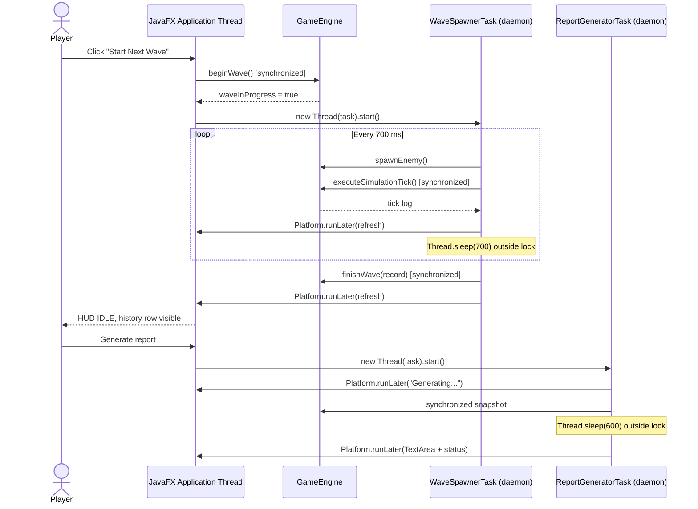

# Design and Multithreading Report

## 1. Architecture Overview

The project follows a small MVC-style separation:

| Layer | Package | Responsibility |
| :--- | :--- | :--- |
| Model | `td.model` | Towers, enemies, interfaces, game records. Pure Java, no JavaFX imports. |
| Exceptions | `td.exception` | Checked failures for gold and placement rules. |
| Service / controller | `td.service` | Game state, validation, tick simulation, background workers. |
| View | `td` (`TowerDefenseApp`) | Programmatic JavaFX controls, event handlers, tables, alerts. |

`TowerDefenseApp` never implements game rules. It translates clicks into
`GameEngine` calls, catches the checked exceptions, and renders snapshots of the
engine state. This keeps the GUI code thin and the logic testable without a window.

---

## 2. OOP Pillars

### 2.1 Encapsulation

Every model field is private:

- `Tower`: `id`, `name`, `cost`, `damage`, `range`, `level`, `row`, `col`.
- `Enemy`: `id`, `type`, `health`, `maxHealth`, `col`, `rewardGold`, `slowed`.
- `GameEngine`: all collections and state counters.

Access is through getters and narrowly controlled setters such as
`Tower.setDamage`, `Tower.setLevel`, and `Enemy.setHealth` (protected, so only
enemy subclasses can change health). Collections are never exposed directly:
`getTowers()`, `getActiveEnemies()`, `getGameRecords()`, and `getNotifications()`
return defensive `ArrayList` copies. Callers therefore cannot bypass validation by
mutating engine internals.

`GameRecord` is effectively immutable: all fields are final and supplied once by
the constructor.

### 2.2 Inheritance

- `Tower` is the abstract superclass of `ArcherTower`, `MageTower`, and `CannonTower`.
- `Enemy` is the abstract superclass of `GoblinEnemy` and `BossEnemy`.
- Both exception classes inherit from `Exception`.

Shared state and behaviour (position, range check, movement, slowing, health
access) live in the superclass. Subclasses override only what differs.

### 2.3 Runtime Polymorphism

`GameEngine` stores `List<Tower>` and `List<Enemy>`, not subtype lists. During
`executeSimulationTick()`:

```java
for (Tower tower : towers) {
    // ...
    String message = tower.attack(target); // Archer, Mage, or Cannon override
}
```

The JVM chooses the correct `attack` implementation at runtime. Enemy damage is
polymorphic too: `GoblinEnemy.takeDamage` subtracts the full amount, while
`BossEnemy.takeDamage` subtracts 8 armor (minimum 5 damage). The engine treats both
as `Enemy` / `Damageable`.

### 2.4 Abstraction and Interfaces

- `Tower` implements `Upgradable`; `Enemy` implements `Damageable`.
- `GameEngine.upgradeTowerAt` deliberately uses an interface reference:

```java
Upgradable target = tower;
int cost = target.getUpgradeCost();
target.upgrade();
```

- Damage is applied through the abstract `Enemy.takeDamage` implementation,
  satisfying the `Damageable` contract without the caller knowing the subtype.

Abstract methods force concrete subclasses to provide:

- `Tower.attack(Enemy)` and `Tower.getSpecialEffectDescription()`.
- `Enemy.takeDamage(int)` and `Enemy.getTraitDescription()`.

### 2.5 Exception Handling

Two user-defined checked exceptions model expected, recoverable failures:

| Exception | Thrown when |
| :--- | :--- |
| `InsufficientGoldException` | Build or upgrade cost exceeds current gold. |
| `InvalidPlacementException` | Path cell, occupied cell, out-of-bounds cell, unknown tower type, blank commander name, action during a wave, second wave, or wave after the base falls. |

`GameEngine` validates before mutating state, so a failed build or upgrade never
deducts gold and never adds a tower. The UI wraps calls in a multi-catch:

```java
try {
    engine.placeTower(selectedTowerType(), row, col);
} catch (InsufficientGoldException | InvalidPlacementException ex) {
    showWarning("Action Blocked", ex.getMessage());
}
```

`showWarning` displays a `javafx.scene.control.Alert(AlertType.WARNING)` with the
exception message. No failure is silently swallowed.

### 2.6 Collections and Modular Methods

`GameEngine` owns four `ArrayList` collections:

```java
private final List<Tower> towers = new ArrayList<>();
private final List<Enemy> activeEnemies = new ArrayList<>();
private final List<GameRecord> gameRecords = new ArrayList<>();
private final List<String> notifications = new ArrayList<>();
```

The notifications list is capped at 150 entries to keep the UI responsive over long
sessions. Helper methods are small and single-purpose: `placeTower`,
`upgradeTowerAt`, `executeSimulationTick`, `searchTowers`, `beginWave`,
`spawnEnemy`, `finishWave`, `resetGame`, and `createTower`. UI handlers only call
these methods; they do not contain game rules.

---

## 3. Game Loop Design

The game is turn-based in discrete ticks rather than continuous 2D physics:

1. Each wave thread step spawns at most one enemy, if any remain in the queue.
2. `executeSimulationTick()` finds one in-range target per tower and calls
   `tower.attack(target)`.
3. Dead enemies are removed; their `rewardGold` is added to both gold and score.
4. Surviving enemies call `move()`. A slowed enemy consumes one tick without moving.
5. An enemy with `col > 4` has reached the base: one life is lost and the enemy is
   removed.
6. When the queue is empty and no active enemies remain, the wave ends.

The grid is 5 columns wide, so the wave is bounded even without a timer. The task
also has a 60-tick safety cap.

Wave composition:

| Difficulty | Enemies | Composition |
| :--- | :--- | :--- |
| Easy | 3 | 2 Goblins + 1 Armored Ogre |
| Normal | 4 | 3 Goblins + 1 Armored Ogre |
| Hard | 5 | 4 Goblins + 1 Armored Ogre |

The result recorded for a wave is `"BASE BREACHED"` if any enemy reached the base
during that wave, otherwise `"CLEARED"`. The record stores the cumulative score and
remaining lives at completion.

---

## 4. Multithreading

JavaFX has a single application thread. Any long-running work on that thread would
freeze rendering and event handling. Two independent daemon threads keep the GUI
responsive.

### 4.1 Thread 1: `WaveSpawnerTask`

- Implements `Runnable`; started by `TowerDefenseApp` as
  `new Thread(task, "wave-spawner-thread")`.
- Daemon mode lets the JVM exit even if a wave is running.
- Builds the wave queue from the selected difficulty.
- Repeats: spawn one enemy, call `gameEngine.executeSimulationTick()`, dispatch a
  UI refresh, sleep 700 ms.
- Calls `Platform.runLater(onUiRefresh)` after each step so grid, HUD, notifications,
  and tables are updated only on the JavaFX thread.
- On completion, creates a `GameRecord`, marks `waveInProgress = false`, and posts a
  final UI refresh.
- Handles `InterruptedException` by restoring the interrupt flag and adding a
  notification.

### 4.2 Thread 2: `ReportGeneratorTask`

- Implements `Runnable`; started only when the user clicks the report button.
- Daemon thread named `"report-generator-thread"`.
- Immediately posts `"Generating report in background..."` to the status label with
  `Platform.runLater`.
- Sleeps 600 ms to simulate compilation, then enters a `synchronized (gameEngine)`
  block and takes a consistent snapshot of towers, records, gold, lives, enemies,
  and score.
- Formats a multi-line report and pushes it into the `TextArea`, then updates the
  status label, again with `Platform.runLater`.
- The report button guards against launching concurrent report threads.

### 4.3 Synchronization Strategy

All public `GameEngine` methods are `synchronized` on the engine instance. This
protects invariants shared between the JavaFX thread and the worker threads:

- The wave thread mutates towers/enemies/lives/gold while the UI reads HUD values.
- A player click could attempt to build/upgrade while a wave is mutating the board.
- The report thread reads a multi-field snapshot while the wave thread runs.

Additional protections:

1. **`waveInProgress` flag** — `beginWave()` atomically checks and sets it, so two
   waves cannot start. `placeTower` and `upgradeTowerAt` throw
   `InvalidPlacementException` while it is set.
2. **Defensive copies** — UI code iterates snapshots, avoiding
   `ConcurrentModificationException`.
3. **Narrow critical sections** — no `Thread.sleep` occurs inside a synchronized
   engine method; the wave thread only holds the lock for one tick of computation.
4. **UI-thread confinement** — all control mutation happens in `Platform.runLater`,
   never from the worker thread directly.
5. **Reentrant locking** — `ReportGeneratorTask` wraps reads in
   `synchronized (gameEngine)`; the synchronized getters re-enter the same monitor
   safely.
6. **Reset guard** — the Reset button is rejected while a wave is running, preventing
   a reset from invalidating a wave thread's in-flight state.
7. **Base-fall cleanup** — at zero lives the wave thread clears active enemies and
   prevents further waves until reset.

### 4.4 Thread Interaction Sequence



### 4.5 Why Not Do This on the JavaFX Thread?

- The 700 ms wave cadence and 600 ms report delay would block event handling and
  freeze the window if executed on the FX thread.
- The design uses standard `Thread` + `Runnable` (rather than `Task`/`Service`) to
  satisfy the explicit rubric requirement and to keep the concurrency model visible
  in the code.

---

## 5. Design Trade-offs and Limitations

- **Grid, not vector physics**: a 5x5 `GridPane` of `Button` cells is intentional.
  It is easy to grade, directly uses JavaFX controls, and avoids sprite/collision
  complexity.
- **In-memory only**: no files or database. Restarting the application clears all
  state, as permitted by the specification.
- **Fixed path**: enemies walk row 2 from column 0 to column 4; this keeps range
  calculations stable and Manhattan-based.
- **One attack per tower per tick**: prevents a single tower from damaging every
  enemy in range on the same tick and keeps wave pacing predictable.
- **Simulated report delay**: the 600 ms sleep makes the background behaviour
  observable; the aggregation itself is real.
- **No FXML/CSS**: all layout and inline styling live in `TowerDefenseApp`, so the
  project has no classpath resource-loading failure points.

---

## 6. Requirements Traceability

| Rubric item | Concrete evidence |
| :--- | :--- |
| 8+ meaningful classes | 16 source files across four packages. |
| Abstract classes | `Tower`, `Enemy`. |
| Interfaces via references | `Upgradable target` in `GameEngine`; `Damageable` implemented by `Enemy`. |
| Inheritance + polymorphism | Tower/enemy subclasses with overridden `attack` / `takeDamage`. |
| Collections | Four `ArrayList`-backed lists in `GameEngine`. |
| Exceptions | Two custom checked exceptions, validated before mutation, shown via `Alert`. |
| JavaFX views | Setup/HUD bar plus 3-tab `TabPane`, `GridPane`, `TableView`, `ListView`, `TextArea`, `ComboBox`, `Alert`. |
| Multithreading | `WaveSpawnerTask` + `ReportGeneratorTask`, `Platform.runLater`, synchronized state. |
| Documentation | README, UML, design/multithreading report, test cases. |
