# UML Class Diagram

The diagram contains every production class in the project: 2 interfaces,
2 abstract classes, 8 concrete model/data classes, 2 exceptions, 3 services,
and the JavaFX application class.

```mermaid
classDiagram
    direction LR

    class Upgradable {
        <<interface>>
        +upgrade() void
        +getUpgradeCost() int
        +getLevel() int
        +getUpgradeSummary() String
    }

    class Damageable {
        <<interface>>
        +takeDamage(int amount) void
        +isDead() boolean
        +getHealth() int
        +getMaxHealth() int
    }

    class Tower {
        <<abstract>>
        -id : String
        -name : String
        -cost : int
        -damage : int
        -range : int
        -level : int
        -row : int
        -col : int
        +Tower(name, cost, damage, range, row, col)
        +attack(Enemy target) String*
        +getSpecialEffectDescription() String*
        +isInRange(Enemy enemy) boolean
        +getUpgradeSummary() String
        +getId() String
        +getName() String
        +getCost() int
        +getDamage() int
        +setDamage(int) void
        +getRange() int
        +setRange(int) void
        +getLevel() int
        +setLevel(int) void
        +getRow() int
        +getCol() int
    }

    class ArcherTower {
        +ArcherTower(row, col)
        +attack(Enemy target) String
        +upgrade() void
        +getUpgradeCost() int
        +getSpecialEffectDescription() String
    }

    class MageTower {
        +MageTower(row, col)
        +attack(Enemy target) String
        +upgrade() void
        +getUpgradeCost() int
        +getSpecialEffectDescription() String
    }

    class CannonTower {
        +CannonTower(row, col)
        +attack(Enemy target) String
        +upgrade() void
        +getUpgradeCost() int
        +getSpecialEffectDescription() String
    }

    class Enemy {
        <<abstract>>
        -id : String
        -type : String
        -health : int
        -maxHealth : int
        -col : int
        -rewardGold : int
        -slowed : boolean
        +Enemy(type, health, rewardGold)
        +takeDamage(int amount) void*
        +getTraitDescription() String*
        +move() void
        +applySlow() void
        +hasReachedBase() boolean
        +isDead() boolean
        +getId() String
        +getType() String
        +getHealth() int
        +getMaxHealth() int
        +getCol() int
        +getRewardGold() int
        +isSlowed() boolean
    }

    class GoblinEnemy {
        +GoblinEnemy()
        +takeDamage(int amount) void
        +getTraitDescription() String
    }

    class BossEnemy {
        -armor : int
        +BossEnemy()
        +takeDamage(int amount) void
        +getTraitDescription() String
        +getArmor() int
    }

    class GameRecord {
        -waveNumber : int
        -playerName : String
        -difficulty : String
        -score : int
        -remainingLives : int
        -result : String
        -timestamp : String
        +GameRecord(waveNumber, playerName, difficulty, score, remainingLives, result, timestamp)
        +getWaveNumber() int
        +getPlayerName() String
        +getDifficulty() String
        +getScore() int
        +getRemainingLives() int
        +getResult() String
        +getTimestamp() String
    }

    class InsufficientGoldException {
        +InsufficientGoldException(String message)
    }

    class InvalidPlacementException {
        +InvalidPlacementException(String message)
    }

    class GameEngine {
        -towers : List~Tower~
        -activeEnemies : List~Enemy~
        -gameRecords : List~GameRecord~
        -notifications : List~String~
        -playerName : String
        -difficulty : String
        -gold : int
        -lives : int
        -currentWave : int
        -score : int
        -waveInProgress : boolean
        +placeTower(String, int, int) Tower
        +upgradeTowerAt(int, int) void
        +executeSimulationTick() List~String~
        +searchTowers(String) List~Tower~
        +beginWave() void
        +spawnEnemy(Enemy) void
        +finishWave(GameRecord) void
        +clearActiveEnemies() void
        +resetGame() void
        +addNotification(String) void
        +getTowerAt(int, int) Tower
        +getTowers() List~Tower~
        +getActiveEnemies() List~Enemy~
        +getGameRecords() List~GameRecord~
        +getNotifications() List~String~
        +getPlayerName() String
        +setPlayerName(String) void
        +getDifficulty() String
        +setDifficulty(String) void
        +getGold() int
        +getLives() int
        +getCurrentWave() int
        +getScore() int
        +isWaveInProgress() boolean
    }

    class WaveSpawnerTask {
        -gameEngine : GameEngine
        -onUiRefresh : Runnable
        +WaveSpawnerTask(GameEngine, Runnable)
        +run() void
        -buildWave() List~Enemy~
    }

    class ReportGeneratorTask {
        -gameEngine : GameEngine
        -reportConsumer : Consumer~String~
        -statusConsumer : Consumer~String~
        +ReportGeneratorTask(GameEngine, Consumer, Consumer)
        +run() void
    }

    class TowerDefenseApp {
        -engine : GameEngine
        -cellButtons : Button[][]
        -goldLabel : Label
        -livesLabel : Label
        -waveLabel : Label
        -scoreLabel : Label
        -threadStatusLabel : Label
        -notificationList : ListView~String~
        -armoryTable : TableView~Tower~
        -historyTable : TableView~GameRecord~
        -reportArea : TextArea
        +start(Stage) void
        +stop() void
        +main(String[]) void
        -buildTopBar() VBox
        -buildTabs() TabPane
        -buildBattlefieldTab() BorderPane
        -buildArmoryTab() VBox
        -buildHistoryTab() VBox
        -handleCellClick(int, int) void
        -handleStartWave() void
        -handleSetPlayer() void
        -handleGenerateReport() void
        -refreshAll() void
    }

    Upgradable <|.. Tower
    Damageable <|.. Enemy

    Tower <|-- ArcherTower
    Tower <|-- MageTower
    Tower <|-- CannonTower

    Enemy <|-- GoblinEnemy
    Enemy <|-- BossEnemy

    Exception <|-- InsufficientGoldException
    Exception <|-- InvalidPlacementException

    GameEngine o-- "*" Tower : manages
    GameEngine o-- "*" Enemy : spawns / advances
    GameEngine o-- "*" GameRecord : records
    GameEngine ..> Upgradable : upgrades via interface
    GameEngine ..> InsufficientGoldException : throws
    GameEngine ..> InvalidPlacementException : throws

    Tower ..> Enemy : attacks
    Enemy ..> Damageable : fulfils contract

    WaveSpawnerTask ..> GameEngine : mutates on background thread
    WaveSpawnerTask ..> GameRecord : creates
    ReportGeneratorTask ..> GameEngine : reads snapshot

    TowerDefenseApp ..> GameEngine : controls
    TowerDefenseApp ..> WaveSpawnerTask : starts Thread
    TowerDefenseApp ..> ReportGeneratorTask : starts Thread
    TowerDefenseApp ..> Tower : displays
    TowerDefenseApp ..> GameRecord : displays
```

## Relationship Summary

| Relationship | Meaning |
| :--- | :--- |
| `Upgradable <|.. Tower` | `Tower` implements the upgrade contract. |
| `Damageable <|.. Enemy` | `Enemy` implements the health/damage contract. |
| `Tower <|-- ArcherTower` (etc.) | Tower inheritance and runtime attack polymorphism. |
| `Enemy <|-- GoblinEnemy` / `BossEnemy` | Enemy inheritance and overridden `takeDamage`. |
| `GameEngine o-- Tower/Enemy/GameRecord` | Engine owns the in-memory `ArrayList` collections. |
| `WaveSpawnerTask ..> GameEngine` | Background wave worker updates synchronized state. |
| `ReportGeneratorTask ..> GameEngine` | Background report worker reads a synchronized snapshot. |
| `TowerDefenseApp ..> services` | JavaFX view creates and starts both daemon threads. |

## Notes on Multiplicity

- `GameEngine` owns `0..*` towers, `0..*` active enemies, and `0..*` records.
- Each `Tower` occupies exactly one `(row, col)` cell; row 2 is reserved for enemies.
- Each `GameRecord` describes exactly one completed wave.
- `TowerDefenseApp` creates one `GameEngine` and at most one wave thread and one report
  thread at a time.
